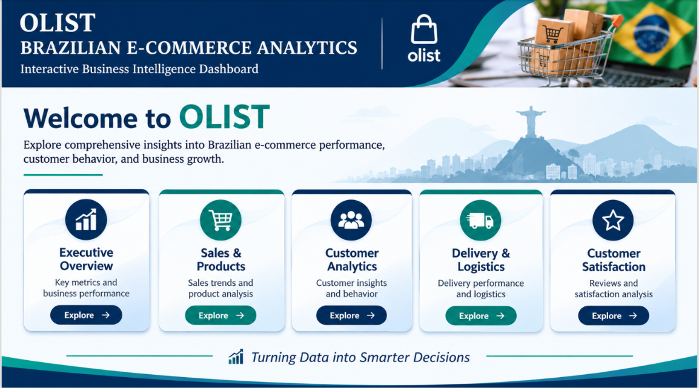
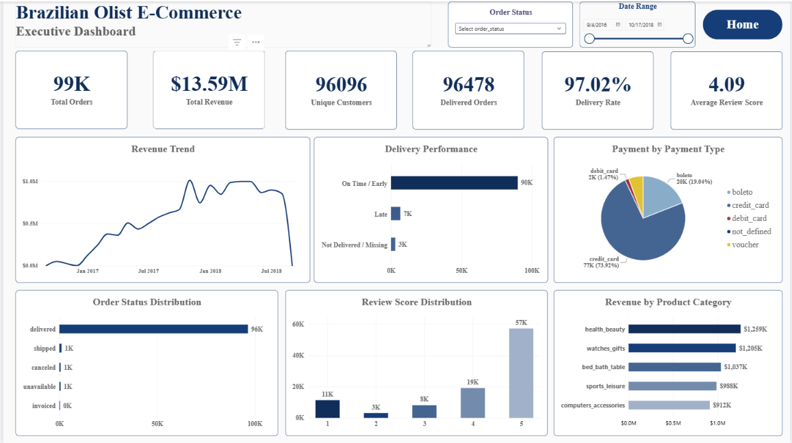
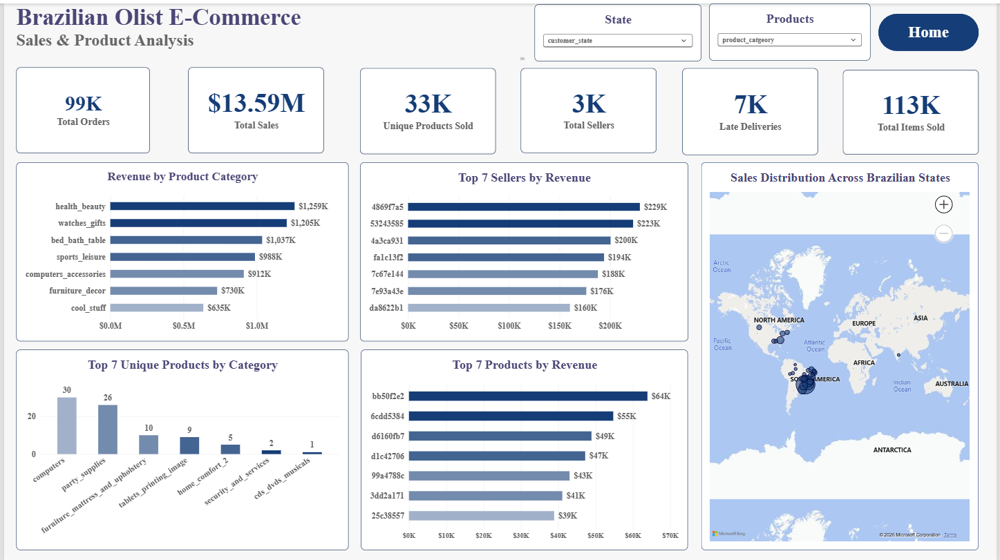
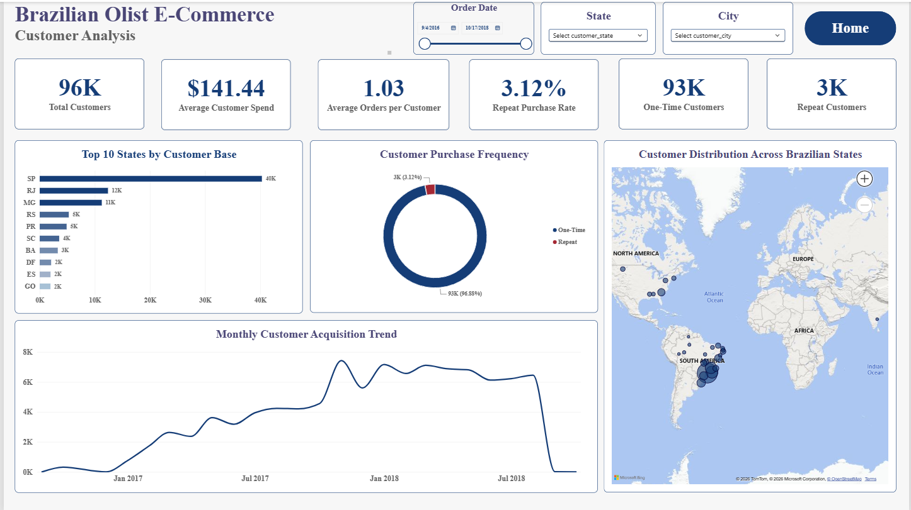
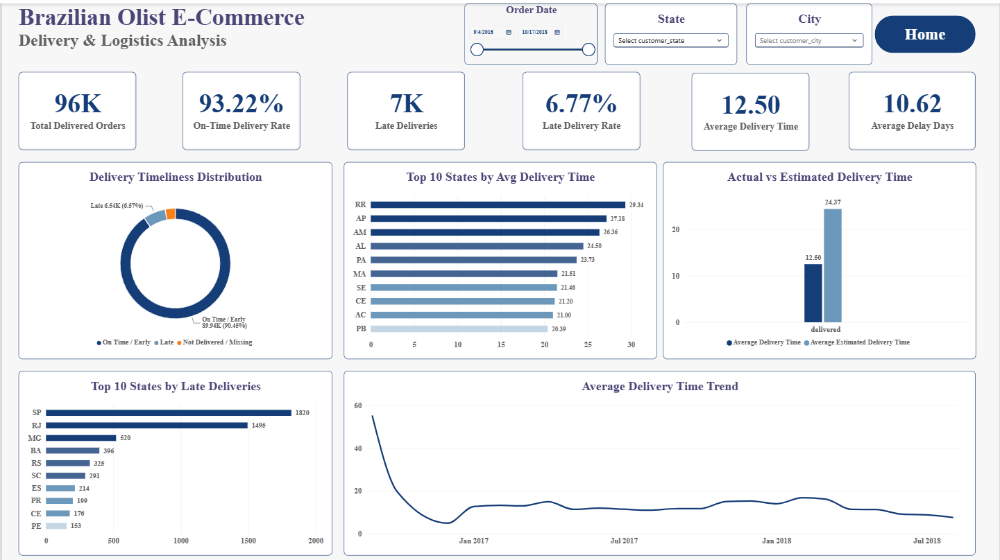
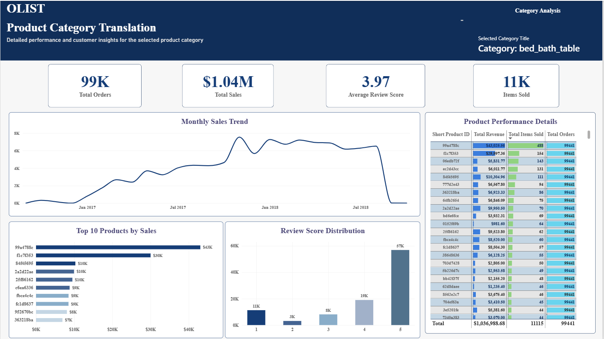
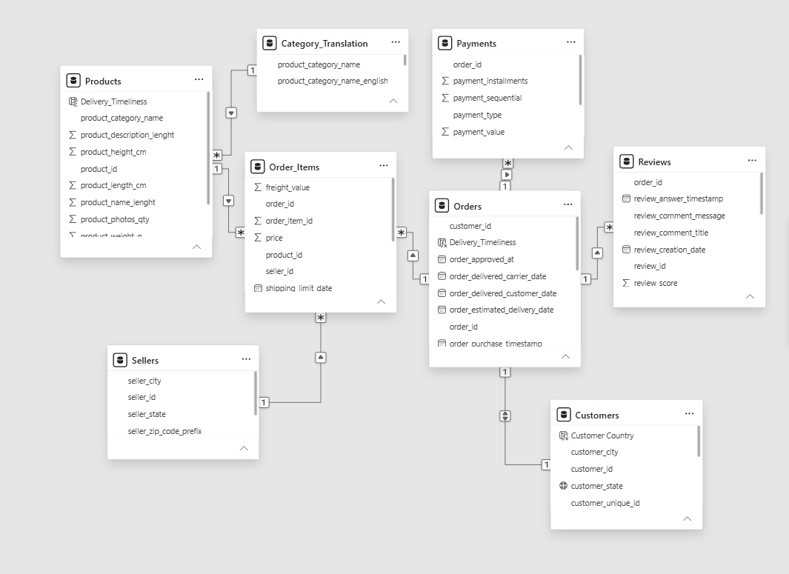

# Brazilian E-Commerce Data Analytics

### End-to-End Business Analysis & Interactive Dashboard Development

An end-to-end data analytics project using the **Olist Brazilian E-Commerce Public Dataset** to explore sales performance, customer purchasing behavior, delivery operations, product performance, and customer satisfaction.

The project includes data exploration and analysis in Excel, data modeling and interactive dashboard development in Power BI, and documented business insights.

---

## Project Overview

The objective of this project is to transform raw e-commerce data into meaningful business insights through data preparation, analytical calculations, data modeling, and interactive visualizations.

The analysis focuses on understanding marketplace performance and identifying potential opportunities related to customer retention, delivery efficiency, sales performance, and customer experience.

## Project Status

- Excel Analysis: Completed
- Power BI Dashboard: Completed
- Project Documentation: Completed
- SQL Business Analysis: Planned

## Tools & Technologies

| Tool | Purpose |
|---|---|
| Microsoft Excel 2019 | Data exploration and analysis |
| Power Query | Data preparation and transformation |
| Microsoft Power BI | Data modeling and interactive dashboards |
| DAX | Measures and business KPI calculations |

## Dataset Overview

The project uses the Olist Brazilian E-Commerce Public Dataset.

| Dataset | Records |
|---|---:|
| Orders | 99,441 |
| Customers | 99,441 |
| Order Items | 112,650 |
| Payments | 103,886 |
| Sellers | 32,951 |
| Distinct Review IDs | 98,410 |

## Key Business Metrics

| Metric | Result |
|---|---:|
| Total Sales | R$ 13.59M |
| Total Orders | 99,441 |
| Unique Customers | 96,096 |
| Total Items Sold | 112,650 |
| Repeat Purchase Rate | 3.12% |
| On-Time Delivery Rate | 93.22% |
| Late Deliveries | 6,535 |
| Average Review Score | 4.09 / 5 |
| Positive Review Rate | 77.14% |

*Note: Sales are reported in Brazilian Real (R$). Complete cost information is unavailable, so actual profit and profit margin are not calculated.*

## Excel Analysis

**Workbook:** `Olist_Excel_Analysis.xlsx`

The workbook contains:

- README
- Orders_Analysis
- Orders_Data
- Customers_Data
- Order_Items_Data
- Payments_Data
- Products_Data
- Sellers_Data
- Reviews_Data
- Category_Translation

## Power BI Dashboard

A seven-page interactive Power BI report was developed using a consistent Light Executive theme, teal accents, and Segoe UI typography.

### Dashboard Pages

1. Home and Navigation
2. Executive Overview
3. Sales and Product Analysis
4. Customer Analytics
5. Delivery and Logistics Analysis
6. Customer Satisfaction
7. Category Details (Drill-Through)

### Dashboard Features

- Interactive KPI cards and visualizations
- Slicers and dynamic filtering
- Cross-filtering between visuals
- Drill-through analysis
- Dynamic DAX measures
- Customer purchase-frequency analysis
- Review sentiment analysis
- Geographic sales visualization
- Consistent report navigation and design

## Dashboard Previews

### Home Page



### Executive Overview



### Sales and Product Analysis



### Customer Analytics



### Delivery and Logistics



### Customer Satisfaction


### Category Details



### Power BI Data Model



## Key Analytical Insights

- The observed repeat purchase rate was 3.12%, indicating that most customers placed only one order during the available dataset period.
- The on-time delivery rate was 93.22%, while 6,535 orders were classified as late.
- The average customer review score was 4.09 out of 5.
- Average review scores differed across delivery categories: 4.29 for On Time/Early, 2.27 for Late, and 1.76 for Not Delivered/Missing.
- Delivery performance and review scores showed an association, highlighting an area for further business investigation.

## Repository Structure

```text
Olist_Ecommerce_Project/
│
├── 01_Dataset/
├── 02_Excel_Analysis/
│   └── Olist_Excel_Analysis.xlsx
├── 03_PowerBI_Dashboard/
│   └── Olist_ECommerce_Analytics.pbix
├── 04_Documentation/
│   ├── Dashboard_Screenshots/
│   │   ├── Excel/
│   │   └── PowerBI/
│   ├── Olist_Ecommerce_Analytics_Project_Report.docx
│   └── Olist_Ecommerce_Analytics_Project_Report.pdf
│
└── README.md
```

## Data Limitations

- Complete cost information is unavailable; actual profit and profit margin are not calculated.
- Repeat purchase rate represents activity within the observed dataset period, not lifetime customer loyalty.
- Some orders have missing delivery information.
- Review records contain duplicate review identifiers; distinct identifiers are used for review-count calculations.
- Customer reviews are associated with orders rather than individual products.
- Delivery and review-score comparisons indicate association, not proven causation.

## Future Scope

SQL Business Analysis is planned as the next phase of this project.

The planned work includes relational database design, SQL joins, aggregations, subqueries, CTEs, window functions, and business-focused analytical queries.

## Project Documentation

The complete project report is available at:

`04_Documentation/Olist_Ecommerce_Analytics_Project_Report.pdf`

It covers the project methodology, dataset, Excel analysis, Power BI data modeling, DAX measures, dashboards, findings, business insights, and limitations.

---

**Project Category:** Data Analytics | Business Intelligence | E-Commerce Analytics

**Developed as an independent portfolio project.**